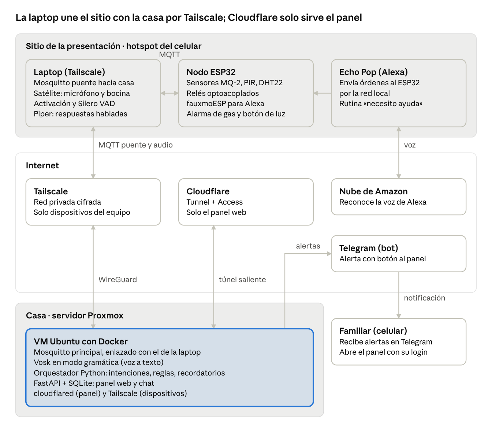
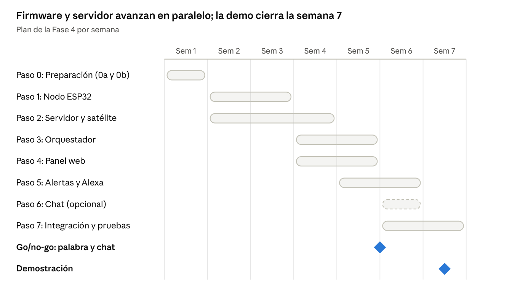

# Fase 4: Desarrollo e Integración — Asistente de Voz

Sep 26, 2026 · @Ilse

## Introducción y objetivo de la fase

La Fase 4 convierte el diseño de las Etapas 4 y 5 en un prototipo funcional e integrado, que se construirá en 7 semanas. Al terminar, el usuario podrá controlar luces, pedir ayuda y recibir recordatorios por voz, y sus familiares recibirán alertas y podrán comunicarse con él desde un panel web.

La fase se desarrolla por capas: cada componente se prueba por separado y después se integra con los demás. Así, cuando algo falla, se sabe en qué capa está el problema.

Criterios de éxito de la fase:

- A 1.5 metros del micrófono, la luz se enciende y el asistente lo confirma en menos de 2.5 segundos en la demostración (servidor remoto) y de 2 segundos en una instalación real, contados desde que el usuario termina de hablar. Si la palabra de activación no pasa su go/no-go, se mide igual con la tecla para hablar.
- Las alertas de gas y de auxilio llegan por Telegram con un enlace al panel web.
- En una instalación real, la voz y la automatización funcionan sin Internet. En la demostración, si se pierde la conexión con el servidor, la alarma local de gas sigue funcionando.
- El familiar puede ver el estado de la sala y recibir alertas desde el panel web.

## Alcance del prototipo

El prototipo cubre una sola sala con una luz controlada y un nodo de sensores. Lo que queda fuera se documenta para no confundir el alcance:

- Varias habitaciones, varios nodos o varias luces.
- Varios micrófonos distribuidos en la casa, o captación desde cualquier punto de la sala: con un micrófono inalámbrico con receptor USB-C, el usuario debe estar a 1.5 m o menos. Un arreglo de micrófonos queda como mejora futura.
- Control de cargas a 127 V; la demostración usa cargas de bajo voltaje.
- Detección de caídas, llamadas telefónicas automáticas y SMS.
- Apps nativas y publicación en tiendas: el panel se entrega como versión web (Safari en iPhone y iPad, Chrome en Android); la APK de Android queda como trabajo futuro. Sin App Store ni Google Play.
- El chat de dos vías es opcional: se integra solo si el resto está terminado (Paso 6).
- Detección certificada de gas: el MQ-2 con buzzer es un prototipo; una instalación real debe usar un detector de gas certificado.
- Crear recordatorios por voz: en el prototipo se crean desde el panel.

## Organización pendiente

Estos datos se definen en el Paso 0 y se agregan a este documento:

- [ ] Fecha de inicio, fecha de fin y fecha de presentación.
- [ ] Responsable de cada paso del plan.
- [ ] Presupuesto: micrófono, relés, fuentes, servidor, y qué equipo es propio o prestado (el dominio ya no se compra: Funnel).
- [x] Confirmar la laptop con Omarchy que funciona como satélite de voz (sin puente).
- [x] Panel web con administradores, publicado por Tailscale Funnel (sin dominio propio).
- [ ] Probar la administración remota del servidor (Proxmox y SSH por Tailscale) desde la laptop, con datos móviles.
- [ ] Reservar el lugar de la presentación y saber cuántos equipos se conectarán a la vez.
- [ ] Medir la velocidad de subida de datos móviles en el lugar, con el hotspot.
- [ ] Anotar la versión de iOS del iPhone y del iPad.
- [ ] Decidir si el asistente usa una VM dedicada (recomendado) o la VM actual, que comparte recursos con 11 servicios personales.

## Estado de la implementación

Corte al 30 de octubre de 2026. El desarrollo avanzó con arranque anticipado y el plan se actualizó con las decisiones tomadas (commits `f556110` y `5b41fbe`).

| Componente | Estado | Evidencia |
| --- | --- | --- |
| Broker Mosquitto del servidor (Paso 0b) | Implementado y probado | Commit `05141ff`; contenedor *healthy*; matrices de permisos con 0 discrepancias. |
| Firmware del nodo ESP32 (Paso 1) | Implementado y probado en hardware | Sensores reales (`d50c8ff`), relé (`0fa96f8`), buzzer con diodo (`db9c141`); pruebas en hardware en curso. |
| NTP del servidor (chrony) | Implementado y probado | `chronyc` activo (stratum 3) al 30 oct; el ESP32 usa la VM como primario. |
| ESP32 conectado a la VM por USB | Implementado y probado | Hardware conectado; pruebas en hardware en curso. |
| Satélite de voz (laptop con Omarchy, sin puente) | Implementado y probado | Tecla F9 y botón del panel; commit `c9d88ef` (28 oct). |
| Orquestador, panel y alertas | Implementado y probado | Reporte «2026-10-06 - Implementacion - Etapa 1»; chat, panel y administradores (`a40e54e`, `1a2f6dc`). |
| Panel: P33 (casa sin salida a Internet) | Pendiente | No ejecutable hoy: exige apagar el WAN del router. Escucha LAN ya configurada y probada. |
| Servidor de voz (Vosk, etapa A) | Implementado y probado en vivo | Reporte «2026-10-11»; gramática cerrada; arnés 13/18 aciertos. |
| Chat de dos vías | Implementado y probado | Commit `8cf97d8` (27 oct); pruebas en verde. |
| Funciones nuevas (hora, fecha, temperatura, recordatorios, «estoy bien», «cancela», YouTube por voz) | Implementado y probado (YouTube desplegado, prueba física pendiente) | Commits `efcf2fb`, `927f1f3`, `51aeb8b`, `92e535f`. |

## Funciones agregadas durante la implementación

| Función | Fecha | Estado |
| --- | --- | --- |
| Chat de dos vías | 27 oct | Implementado y probado (orquestador y panel, pruebas en verde) |
| Botón «Mantener para hablar» | 28 oct | Implementado y probado (equivalente a F9, panel y satélite) |
| Familiares e invitación por enlace desde el panel | 28 oct | Implementado y probado (código de un solo uso, enlace de invitación) |
| Frases de hora, fecha, temperatura, recordatorios y «estoy bien» | 28 oct | Implementado y probado en el orquestador de voz |
| «cancela» como falsa alarma | 28 oct | Implementado y probado (cancela una ayuda reciente) |
| YouTube por voz | desplegado 29 oct | Desplegado; prueba física pendiente |

### Broker del servidor

- Mosquitto 2.0.22 en Docker, en la VM `villaca`, con tres listeners IPv4 (loopback, red de la casa y Tailscale) y sin exposición a Internet. El detalle está en «Configuración del broker del servidor».
- Cinco usuarios con ACL verificada publicando cada tópico como su publicador real y comprobando quién lo recibe.
- Lecciones de la implementación: con MQTT 3.1.1, un mensaje rechazado por la ACL no da error a quien lo publica; el archivo de contraseñas solo se puede leer si el contenedor arranca como el usuario 1883; y Docker Compose interpreta `$SYS` como variable, así que se escribe `$$SYS`.

### Firmware del nodo

- **Herramienta y entornos:** PlatformIO, en `firmware/`, con tres entornos: `nodemcu-32s` (instalación), `nodemcu-32s-test` (con `PRUEBAS=1`, el único que acepta `prueba_gas` y el comando de gas por monitor serie) y `depurar` (pruebas con registro detallado). Usa el 15 % de la RAM y el 77 % de la memoria flash.
- **Versiones fijas:** `platformio/espressif32@6.12.0` (core de Arduino 2.0.17), `cyijun/ESP32MQTTClient@1.1.5`, `vintlabs/FauxmoESP@3.4.1` y `bblanchon/ArduinoJson@7.4.3`. AsyncTCP la aporta el core; declararla aparte duplicaba el código y rompía la compilación.
- **Funciones implementadas:** Wi-Fi y MQTT con reconexión; luz con la regla del `ts` para órdenes por MQTT; botón BOOT; sensores simulados (gas constante en 312 y presencia que alterna cada 3 minutos); alarma de gas con histéresis y buzzer; alertas con su `id` y una cola de 8 en RAM que solo libera una alerta cuando el broker confirma su recepción (PUBACK); hora por SNTP; Alexa con «Luz de la sala» y «Ayuda»; y `nodo/estado` cada 60 segundos.
- **Pines:** LED integrado en GPIO 2 (hace de luz), BOOT en GPIO 0 (pulsación corta alterna la luz; pulsación larga de 4 s reinicia el ESP32), relé en GPIO 26, buzzer en GPIO 27, botón externo en GPIO 33, MQ-2 en GPIO 34, DHT22 en GPIO 32 y PIR en GPIO 35.
- **Secretos:** las credenciales de Wi-Fi y MQTT y la dirección del broker van en `firmware/include/secrets.h`, ignorado por git; el resto de la configuración va en `config.h`.
- **Errores corregidos al revisar el código contra el plan:** las órdenes de luz por MQTT no se aplicaban, las de Alexa se descartaban por no traer `ts`, con la red caída no funcionaba nada local, el botón BOOT no alternaba la luz, los sensores nunca se publicaban, el gas se muestreaba demasiado rápido, cada mensaje se procesaba dos veces y el ESP32 no reintentaba la conexión si el broker no respondía al arrancar.
- **Actualización del 19 de octubre (sensores reales, origen de arranque y hora):** los sensores de ambiente ya no son simulados. El DHT22 se lee en GPIO 32 (con librería `adafruit/DHT sensor library@1.4.7` y `Adafruit Unified Sensor@1.1.15`), con una lectura como mucho cada 2 s y tres fallos seguidos para pasar a `null`; el MQ-2 real se lee en GPIO 34 y sale `null` durante sus 3 minutos de calentamiento. Se borraron `SIM_TEMP_*`, `SIM_HUM_*` y `SIM_GAS_POR_DEFECTO` (solo queda `SIM_PRESENCIA_PERIODO_S` como respaldo del PIR). Cuando un sensor no tiene dato, el campo viaja como `null` (no como `0`) en `sensores` y `nodo/estado`, y `gas` no evalúa umbrales con un valor ausente. El nodo publica `luz/estado` con origen `arranque` al encenderse en frío (ese origen no entra en la validación de `luz/set`). La hora usa la VM como NTP primario (`192.168.1.169`) y `pool.ntp.org` como respaldo, con reintento cada 5 s y `ts:null` mientras no haya hora válida.

### Servidor de voz (Paso 2, etapa A)

- **Servicio:** `servidor/voz/` con Vosk en Docker (imagen `asistente-voz:1.0`), WebSocket en los tres listeners de la VM (loopback, red de la casa y Tailscale, nunca `0.0.0.0`) en el puerto 2700, y usuario MQTT `voz` con permiso de escribir solo en `casa/sala/voz/texto`.
- **Modelo:** `vosk-model-small-es-0.42` (descargado con sha256 verificado, ~58 MB) y gramática cerrada de 18 frases + `[unk]` en formas sin tilde («ayudame», «olvidalo»). Al arrancar se vigila el vocabulario: si el modelo no conoce una palabra de la gramática, se avisa en el log («no se cambia sola»).
- **Protocolo de audio:** tramas PCM 16 kHz mono 16-bit LE de 3200 B (100 ms); `{"tipo":"inicio","token":...}` y `{"tipo":"fin"}`; respuestas `{"tipo":"frase"}` y `{"tipo":"final"}` con `frase_id`, y publicación MQTT con `modo`, `ts` y `marcas` de cada etapa. Límites probados con el arnés: trama máxima 3200 B, frase de 10 s e inactividad de 3 s.
- **Orquestador:** se suscribe a `casa/sala/voz/texto`, responde el eco controlado por `ECO_VOZ`, y despacha los tópicos en `orquestador.enrutar`. Pruebas nuevas de regresión: 283, sin fallos (antes 252).
- **Mediciones de la etapa A** (arnés `herramientas/arnes_wav.py`, voz sintética de Piper): 11–15 de 18 frases exactas según la corrida; las confusiones son entre variantes cercanas («prende/enciende», verbo inicial perdido); 1–3 de 8 frases fuera de la gramática se reconocen como otra frase; latencia del VAD fin → `final` de Vosk 6–14 ms y → publicado en MQTT 6–15 ms; RAM del contenedor ~136 MiB (límite 512 MiB) y CPU 3–4 % solo mientras se reconoce.

### Pendientes antes de las pruebas en hardware

- [x] Conectar el ESP32 a la VM en Proxmox (Hardware → Add → USB Device) y agregar al usuario al grupo `dialout`. (30 oct)
- [ ] Corregir en el firmware: client id `nodo-sala` (hoy usa uno derivado de la MAC), reintento de conexión al broker con espera creciente (hoy reintenta cada 50 ms) y documentar la pulsación larga de BOOT.
- [ ] Corregir los comandos de prueba: publicar y escuchar con el usuario `orquestador`, publicar `prueba_gas` con `puente` y cargar las contraseñas del `.env`.
- [ ] Unificar el formato del campo `ts`: en `luz/set` y `satelite/decir` es epoch en segundos, pero en `nodo/estado` el firmware lo envía como texto ISO 8601.
- [x] Aplicar la configuración de chrony para servir NTP a la red local. (30 oct)
- [ ] Configurar la identidad de git (los commits salen como `ilse@localhost`).
- [ ] Pruebas en hardware: arranque, polaridad del LED, P42, P46, P31, P27, P09, P28, P45 y frecuencia de sensores; con el Echo Pop, el descubrimiento, P05 y P06.

## Ajustes a etapas anteriores

Antes de programar, los documentos previos deben reflejar las decisiones tomadas para esta fase. Los cambios son pequeños, pero evitan contradicciones entre etapas.

| Etapa | Cambios | Motivo |
| --- | --- | --- |
| Etapa 3: Requisitos tecnológicos | El ESP32 deja de procesar voz y solo lee sensores y controla relés. Se agrega un servidor local como unidad de procesamiento. Se usa un micrófono inalámbrico con receptor USB-C en lugar del arreglo de micrófonos de la Etapa 5, con el usuario a 1.5 m o menos. | La Etapa 4 ya separó la voz (servidor) del control físico (ESP32), y un micrófono inalámbrico con receptor USB-C es más fácil de conseguir y suficiente para el prototipo. |
| Etapa 3: Requisitos funcionales | Se agrega un panel para familiares (versión web, Safari en iPhone y iPad y Chrome en Android), accesible desde fuera de la casa, y Alexa como interfaz complementaria de voz. | Nuevas funciones definidas en esta fase. |
| Etapa 5: Componentes de software | Se fijan Vosk + Piper como motor de voz y Python como orquestador. Se agregan FastAPI (backend del panel) y Tailscale Funnel (acceso remoto, etapa 2 del panel). Se usa Telegram para alertas y se descarta Twilio/SMS. | Hay que elegir una sola opción antes de programar; Telegram es gratuito y su API es oficial. |

## Arquitectura actualizada del sistema

El servidor se queda fijo en casa, en una VM de Proxmox, y concentra la voz, la lógica y el panel web. En el montaje real, el ESP32 está en la red de la casa y se conecta directo al broker del servidor; la laptop con Omarchy es solo satélite de voz y se conecta al servidor por Tailscale (WebSocket para el audio y MQTT para las respuestas); el panel sale por Tailscale Funnel. En el sitio de la demo, la laptop (satélite), el nodo ESP32 y el Echo Pop se conectan al hotspot del celular. El Wi-Fi del lugar queda como respaldo.



*Arquitectura · sitio de la demo, Internet y servidor en casa*

Mosquitto local y bridge de la laptop: **descartado el 30 oct** (motivo: la laptop es solo satélite de voz con Omarchy; el ESP32 se conecta directo al broker del servidor por la red de la casa, lo que simplifica el montaje y evita mantener un segundo broker). Se conserva esta nota y la configuración de referencia por si se necesita en el futuro.

El panel web se publica por Tailscale Funnel desde un nodo dedicado (`asistente`, solo para eso y sin acceso a la tailnet), porque los familiares de una instalación real no tendrían Tailscale. Tailscale también sirve para administrar Proxmox y la VM por SSH desde la laptop.

Hay dos escenarios de falla distintos. Si se pierde la conexión con el servidor, el satélite deja de funcionar y la voz se interrumpe; el ESP32 sigue con la alarma local de gas y el botón de luz, y el panel muestra «sitio sin conexión». Si el sitio se queda sin Internet, además deja de funcionar Alexa, y solo quedan la alarma local de gas y el botón de luz.

### Modos de operación

El código es el mismo en ambos modos; solo cambian las direcciones del archivo de configuración.

| Modo | Dónde está el servidor | Qué depende de Internet |
| --- | --- | --- |
| Instalación real | En la misma casa del usuario, en su red local, con el mismo equipo del prototipo; el hardware definitivo es trabajo futuro | Solo Alexa, las alertas de Telegram y el acceso remoto al panel. La voz y las reglas funcionan sin Internet. |
| Demostración | En la casa del equipo, lejos del sitio | El audio de las frases y las respuestas viajan entre la laptop (satélite) y el servidor por Tailscale; el ESP32 se conecta directo al broker del servidor por la red del sitio. Si se pierde la conexión con el servidor, quedan la alarma local de gas, el botón de luz y la luz por Alexa (esta última solo si el sitio sigue con Internet). |

## Decisiones tecnológicas

Cada componente tiene una herramienta asignada. Las decisiones técnicas están cerradas.

| Componente | Elección | Motivo |
| --- | --- | --- |
| Control físico | ESP32 NodeMCU-32S con Arduino Core, ESP32MQTTClient 1.1.5 (cliente MQTT de ESP-IDF) y fauxmoESP | Bajo costo, Wi-Fi integrado y compatibilidad directa con Alexa. Se descartó PubSubClient porque solo publica con QoS 0, y las alertas necesitan QoS 1. |
| Servidor | Servidor Proxmox del equipo, fijo en casa: una VM con Ubuntu Server y Docker, con inicio automático y snapshots. El host enciende solo al volver la corriente (opción de BIOS) y los contenedores se reinician solos | Más potencia que una Raspberry Pi para Vosk. Los snapshots permiten volver atrás si algo se rompe, y Docker permite reinstalar el sistema igual en la casa de un usuario. |
| Red | Hotspot del celular en 2.4 GHz con datos móviles, más un segundo celular de respaldo con el mismo nombre de red y contraseña; el Wi-Fi del lugar solo como último recurso | El ESP32 solo usa 2.4 GHz (en iPhone: «Maximizar compatibilidad»). Con el mismo nombre de red, todos los dispositivos se reconectan solos al respaldo; pasar el Echo Pop a otra red exige reconfigurarlo en la app de Alexa. |
| Mensajería interna | Mosquitto en el servidor; el ESP32 se conecta directo por la red de la casa. (Mosquitto local y bridge de la laptop descartados, 30 oct) | Ligero y con ACL por usuario. El ESP32 se conecta directo al broker del servidor; el bridge se descartó por complejidad (ver arquitectura). |
| Micrófono | Micrófono inalámbrico con receptor USB-C, orientado hacia donde estará el usuario, con cancelación de eco por software (módulo echo-cancel de PipeWire) | Fácil de conseguir y funciona en Linux sin drivers. Como no tiene DSP, el eco se cancela por software, con la laptop como referencia de lo que suena, y se refuerza con la pausa del micrófono. Su alcance práctico es de 1.5 m. |
| Satélite de voz | Laptop con Omarchy como satélite de voz (sin puente): tecla F9 y botón del panel para hablar, Silero VAD y Piper. Envía por Tailscale el audio en tramas mientras el usuario habla y convierte en voz el texto de la respuesta | El micrófono debe estar junto al usuario. Solo viaja el audio de cada frase hacia el servidor y texto de regreso, lo que ahorra datos y reduce la latencia. |
| Palabra de activación | Tecla F9 y botón «Mantener para hablar» del panel (sin palabra de activación); openWakeWord descartado | Descartado: los modelos incluidos son en inglés y una palabra parecida a «Alexa» activaría los dos asistentes a la vez. |
| Fin de frase | Silero VAD en el satélite, con un tiempo máximo de escucha de 8 segundos | Más preciso que webrtcvad con ruido de fondo y corre sin problema en la laptop. Cierra la frase en cuanto el usuario se calla. |
| Voz a texto | Vosk en español (modelo vosk-model-small-es-0.42), en el servidor, en modo gramática con vocabulario cerrado | Funciona sin Internet; un vocabulario corto sube mucho la precisión. |
| Texto a voz | Piper con una voz en español de México (es_MX), en la laptop del satélite; el micrófono se pausa mientras habla | El servidor solo envía texto, así la respuesta no viaja como audio. La pausa evita que el asistente se escuche a sí mismo. |
| Orquestador | Python (asyncio + paho-mqtt), APScheduler con almacén en SQLite, y SQLite para recordatorios, historial de alertas, ids procesados, la lista de familiares y la cola de salida de Telegram (un envío por alerta y por familiar). Los recordatorios se crean y cancelan desde el panel | Un solo lenguaje para toda la lógica del servidor. |
| Reloj | La VM hereda el reloj del host Proxmox, que tiene RTC con batería, y se sincroniza por NTP cuando hay Internet. Además sirve NTP a la red local (chrony), para que el ESP32 tenga hora aun sin Internet. Zona horaria America/Mazatlan | Los recordatorios dependen de la hora correcta, aun después de un corte de luz sin Internet. |
| Backend del panel | FastAPI con REST y WebSocket | Mismo lenguaje que el orquestador; la API sirve después para una app. |
| Frontend del panel | Flutter: versión web para Safari (iPhone y iPad) y Chrome (Android), con el mismo código | En iPhone se evita publicar en la App Store: la web se usa desde Safari y puede agregarse a la pantalla de inicio. En Android se usa la web en Chrome; la APK queda como trabajo futuro. |
| Alertas | Bot de Telegram con long polling y botones «Abrir panel» y «Ya lo atendí» | Gratuito y con API oficial; los botones funcionan sin webhook. Cada familiar se registra en su chat privado enviando /registro con un código de un solo uso que muestra el panel. **Pueden registrarse varios**, y cada alta se suma a la lista, que vive en SQLite: el segundo familiar no sustituye al primero. Cada alerta genera un envío por cada familiar activo, cada uno con sus propios reintentos, así que un teléfono sin cobertura no retrasa el aviso para el resto. /alertas y el botón «Ya lo atendí» responden a cualquiera de los registrados. El coste de dos teléfonos sonando a la vez se acepta: en una alerta de gas, que no le llegue a uno de los dos teléfonos es peor que suene dos veces. |
| Acceso remoto | Tailscale Funnel (no Cloudflare) desde el nodo `asistente`, etiquetado y sin acceso a la tailnet, solo para el panel web | No abre puertos y el panel sale en `https://asistente.tail722206.ts.net` sin que el familiar instale nada. El resto de la API no depende de Funnel: tiene su propia autenticación. |
| Autenticación del panel | Token por familiar emitido desde el panel, guardado con hash en SQLite y enviado en cada petición a FastAPI. El panel tiene administradores; el mismo mecanismo sirve para la web | La web entra por Funnel, así que la API necesita su propia protección. Cualquier dispositivo sin token recibe un error 401. |
| Red del equipo | Tailscale en el servidor, la laptop, el iPad y el teléfono Android, con ACL que solo abren los puertos necesarios y una segunda cuenta de administrador | Red privada cifrada para el puente MQTT, el audio y la administración de Proxmox, sin exponer nada a Internet. El celular del hotspot no la necesita. |
| Alexa | fauxmoESP en el ESP32 con dos dispositivos: «luz de la sala» y un dispositivo virtual «ayuda». La rutina, llamada exactamente «necesito ayuda», enciende «ayuda»; el ESP32 publica la alerta de ayuda y lo vuelve a apagar | Control local de luces y alerta de ayuda sin crear una skill. El Echo descubre los dispositivos por SSDP (multicast en UDP 1900), y el firmware fija el puerto 80, porque fauxmoESP usa el 1901 por defecto. |
| Botón de luz | Pulsador físico en el ESP32 que alterna la luz y publica el estado con origen «boton» | Garantiza que la luz funcione en la demostración sin depender de ninguna nube. |

### Materiales

El equipo ya cuenta con el ESP32, el Echo Pop, el servidor, la laptop, el iPad, el iPhone, el teléfono Android y el celular para el hotspot. El resto se compra el primer día de la semana 1 con envío rápido; el micrófono es el material crítico, porque el satélite empieza en la semana 2. El dominio propio ya no hace falta (etapa 2 del panel): el panel sale por Tailscale Funnel, que no cuesta.

| Material | Uso | Estado |
| --- | --- | --- |
| ESP32 NodeMCU-32S | Nodo de sensores y relés | Disponible |
| Echo Pop | Interfaz de Alexa | Disponible |
| Servidor Proxmox con VM Ubuntu, en casa | Vosk, lógica, broker y panel | Disponible |
| Celular con hotspot | Red del sitio de la demo | Disponible |
| Segundo celular | Hotspot de respaldo con el mismo nombre de red | Por confirmar |
| Laptop | Satélite de voz y Piper en el sitio (sin puente) | Disponible |
| iPad | Pantalla del panel durante la demo | Disponible |
| iPhone | Panel web en Safari y alertas de Telegram | Disponible |
| Teléfono Android | Panel web (Chrome) y alertas de Telegram | Disponible |
| Micrófono inalámbrico con receptor USB-C | Micrófono del satélite | Disponible |
| Bocina USB o de 3.5 mm | Respuestas habladas, conectada a la laptop | La de la laptop (disponible) |
| Sensores MQ-2, PIR HC-SR501 y DHT22 | Gas, movimiento, temperatura y humedad | Disponible |
| Resistencia de 10 kΩ | Pull-up del DHT22, si el módulo no la trae | Por comprar |
| Módulo de relés de 2 canales, compatible con 3.3 V | Control de la luz | Disponible |
| Buzzer activo | Alarma local de gas | Disponible |
| Transistor 2N2222, resistencia de 1 kΩ y diodo 1N4148 | Driver del buzzer | Disponible |
| Pulsador | Botón físico de luz | Por comprar |
| Resistencias de 10 kΩ (lado del sensor) y 20 kΩ (a tierra) | Divisor de voltaje del MQ-2 | Por comprar |
| Tira LED de 12 V con fuente, o LED de 5 V | Carga de bajo voltaje para la demo | Por comprar |
| Fuente de 5 V y 2 A | Alimentación del ESP32 y los relés | Por comprar |
| Protoboard y cables dupont | Montaje del prototipo | Por comprar |
| Dominio propio | Ya no hace falta: el panel sale por Tailscale Funnel (`asistente.tail722206.ts.net`) | — |
| Router portátil | Respaldo si el hotspot aísla a los dispositivos | Por confirmar |

## Contrato de comunicación MQTT

Esta sección es un **borrador**: se revisa y se congela al final del Paso 0, y a partir de ahí firmware, servidor y satélite se desarrollan en paralelo. Los mensajes MQTT son objetos JSON y los tópicos siguen el patrón `casa/<lugar>/<elemento>/<acción>`; los valores de los ejemplos son ilustrativos. El audio no viaja por MQTT (ver «Transporte de audio»). Un cambio después de congelado se registra en el repositorio con fecha y motivo, y se avisa a todo el equipo.

| Tópico | Publica | Escucha | Mensaje de ejemplo |
| --- | --- | --- | --- |
| `casa/sala/luz/set` | Servidor | ESP32 | `{"estado":"on","origen":"voz","ts":1759501234}` |
| `casa/sala/luz/estado` | ESP32 (con *retain*) | Servidor | `{"estado":"on","origen":"alexa"}` |
| `casa/sala/sensores` | ESP32 | Servidor | `{"temp_c":24.5,"hum_pct":60,"gas_adc":312,"presencia":true}` |
| `casa/sala/alerta/gas` | ESP32 | Servidor | `{"id":"a4cf12-b0007-0042","gas_adc":2100}` |
| `casa/sala/alerta/ayuda` | ESP32 (vía Alexa) o servidor (vía voz) | Servidor | `{"id":"a4cf12-b0007-0043","origen":"alexa"}` |
| `casa/sala/alerta/inactividad` | Servidor | Servidor (bot y panel) | `{"id":"srv-0001","minutos":120}` |
| `casa/sala/satelite/decir` | Servidor | Satélite | `{"texto":"Listo, encendí la luz","tipo":"respuesta","ts":1759501234}` |
| `casa/sala/satelite/<client_id>/hablar` | Panel (POST /api/hablar) | Satélite | `{"tipo":"inicio","ts":1759501234}` o `{"tipo":"fin","ts":1759501234}` |
| `casa/sala/satelite/+/video` | Servidor | Satélite | `{"accion":"buscar","consulta":"gatos","ts":1759501234}` o `{"accion":"cerrar","ts":1759501234}` |
| `casa/sala/satelite/<client_id>/estado` | Satélite (*Last Will*, con *retain*) | Servidor | `{"conectado":true}` |
| `casa/sala/nodo/estado` | ESP32 (al conectar y como *Last Will*, con *retain*) | Servidor | `{"conectado":true,"ts":"2026-10-03T18:46:07Z","ip":"192.168.1.123","fw":"1.0.0","gas_adc":312,"alertas_pendientes":0,"gas_episodio":false,"alexa":true}` |
| `casa/sala/nodo/config` | Servidor (con *retain*) | ESP32 | `{"gas_on_adc":1800,"gas_off_adc":1550}` |
| `casa/sala/nodo/prueba_gas` | Laptop (`mosquitto_pub`) | ESP32 compilado con `PRUEBAS=1` | `{"gas_adc":3000}` |
| `casa/sala/voz/texto` | Servidor (servicio de voz, Vosk) | Servidor (orquestador) | `{"frase_id":"arnes-001","texto":"enciende la luz","modo":"comandos","ts":1759501234,"marcas":{"primera_trama_ms":1759501234000,"ultima_trama_ms":1759501234100,"fin_ms":1759501234150,"final_ms":1759501234160,"publicado_ms":1759501234160}}` |
| `$SYS/broker/connection/puente-sitio/state` | (descartado: sin puente) | Servidor | `1` o `0` (histórico) |

Reglas del contrato:

- **Unidades:** `temp_c` en grados Celsius, `hum_pct` en porcentaje, `presencia` booleano. `gas_adc` es la lectura de `analogRead()` en ADC1 con atenuación de 11 dB (0 a 4095); la calibración es por placa.
- **Origen:** solo lo llevan las órdenes, el estado de la luz y las alertas de ayuda. En las órdenes admite `voz`, `alexa`, `panel` o `boton`; en `luz/estado` añade `arranque`, que es el que publica el propio nodo al encenderse en frío (nunca se acepta como origen de una orden).
- **Dos caminos, un estado:** el ESP32 publica `casa/sala/luz/estado` después de cualquier cambio, venga de MQTT, de Alexa o del botón físico. Así el panel nunca muestra un estado viejo.
- **Cuándo habla el asistente:** responde a las órdenes que el usuario le da por voz. Además habla sin orden previa solo en cuatro casos: aviso de gas (una vez por episodio), recordatorios a su hora, mensajes del chat y corrección de una orden fallida. Nunca habla por cambios de estado que vienen de Alexa, del panel o del botón, ni por lecturas de sensores.
- **Confirmación optimista:** el asistente confirma en cuanto publica la orden, en paralelo con el relé. Si `luz/estado` no coincide con lo pedido en 3 segundos, se corrige en voz («No pude encender la luz»).
- **Entrega y duplicados:** órdenes y alertas usan QoS 1, que garantiza la entrega pero puede repetir mensajes. Los `id` procesados se guardan en una tabla de SQLite con índice único durante 7 días, así la deduplicación sobrevive a un reinicio del servidor.
- **Identificador de alertas:** el `id` combina los últimos 6 dígitos hexadecimales de la MAC del nodo, un contador de arranques guardado en memoria no volátil y un contador interno. Así es único aunque el ESP32 se reinicie.
- **Alarma de gas con histéresis:** el episodio empieza cuando la lectura supera `gas_on_adc` (1800 por defecto) en 3 lecturas seguidas (una por segundo) y termina cuando baja de `gas_off_adc` (1550 por defecto) durante 10 segundos. Los dos umbrales son independientes y configurables por `casa/sala/nodo/config`; el de cierre no se calcula como un porcentaje del de apertura, porque el margen útil del MQ-2 depende del sensor y del aire de la casa, no de una cuenta. Los dos se guardan en memoria no volátil, así que el reinicio del ESP32 no los pierde. Cada episodio genera una sola alerta. El buzzer suena todo el episodio sin importar lo demás; las órdenes de voz se siguen atendiendo y «necesito ayuda» siempre se procesa.
- **Antirrebote de ayuda:** tras publicar una alerta de ayuda, el ESP32 ignora nuevas activaciones durante 60 segundos, y el servidor descarta otra alerta de ayuda en esa misma ventana.
- **Frecuencia de sensores:** se publica solo si la temperatura cambia más de 0.3 °C, la humedad más de 2 %, el gas más de 50 unidades o la presencia cambia, y nunca más de una vez cada 10 segundos. Además hay un latido cada 60 segundos.
- **Constantes:** los umbrales de gas viven en el servidor y llegan al ESP32 por `casa/sala/nodo/config`; el ESP32 los guarda en memoria no volátil y sigue funcionando con el último valor aunque no haya servidor. `TIEMPO_INACTIVIDAD_MIN` (120 minutos por defecto) vive en el servidor, que calcula la inactividad a partir de `presencia`, y se ajusta desde el panel.
- **Cómo encuentra el ESP32 al broker:** la laptop anuncia su nombre por mDNS (Avahi) y el ESP32 lo resuelve con `MDNS.queryHost()`; guarda la última dirección encontrada como respaldo. Se conecta con usuario y contraseña propios.
- **Formato de `nodo/estado`:** al conectar y cada 60 segundos, el ESP32 publica los ocho campos del ejemplo: `conectado`, `ts` (hora del ESP32; vacía si todavía no sincroniza), `ip`, `fw` (versión de firmware), `gas_adc`, `alertas_pendientes` (0 a 8), `gas_episodio` y `alexa` (si fauxmoESP quedó habilitado). El *Last Will* publica solo `{"conectado":false}`.
- **Alertas pendientes en el ESP32:** el broker no encola lo que publica el ESP32, así que el propio ESP32 guarda hasta 8 alertas en RAM y las reenvía con el mismo `id` hasta que el broker confirma su recepción. Los reintentos solo cuentan mientras hay conexión MQTT; durante una caída, las alertas esperan.
- **Estado del enlace con el sitio:** con `notifications true`, el puente de la laptop publica `1` en `$SYS/broker/connection/puente-sitio/state` del servidor al conectarse, y deja ahí un *Last Will* que publica `0` si se cae Tailscale. El nombre del tópico sale del `remote_clientid` del puente. Si el servidor ve `0`, el panel muestra «sitio sin conexión» en menos de 90 segundos, aunque el ESP32 siga encendido.
- **Reconexión:** al reconectarse, el ESP32 publica `nodo/estado` con `conectado: true`, el estado de la luz y los sensores.
- **Comando de prueba:** `casa/sala/nodo/prueba_gas` simula una lectura de gas y solo existe en el firmware compilado con `PRUEBAS=1`. La demostración usa ese firmware, porque la variante mínima del guion lo necesita; se publica desde la laptop con `mosquitto_pub` al broker local.
- **Órdenes por voz:** el servicio de voz publica el texto reconocido en `casa/sala/voz/texto` con `modo` (`comandos` o `chat`, para separar lo que se traduce a intenciones de lo que responde el chat), `ts` y unas `marcas` con la hora de cada etapa (primera trama, última trama, fin recibido por el servidor, `final` de Vosk y publicación en MQTT). Todas las marcas son epoch en milisegundos con el reloj del servidor. El orquestador lo escucha, descarta mensajes de `voz/texto` con `ts` de más de 10 s o sin `ts`, y con `ECO_VOZ=1` responde de inmediato un eco por `casa/sala/satelite/decir` («Escuché: …», o «No entendí, ¿puedes repetir?» si el texto está vacío o es `[unk]`). La traducción a intenciones llega en el Paso 3.

### QoS, retención y antigüedad

| Tópico | QoS | Retenido | Lleva `ts` |
| --- | --- | --- | --- |
| `casa/sala/luz/set` | 1 | No | Sí |
| `casa/sala/alerta/gas` | 1 | No | No |
| `casa/sala/alerta/ayuda` | 1 | No | No |
| `casa/sala/alerta/inactividad` | 1 | No | No |
| `casa/sala/satelite/decir` | 1 | No | Sí |
| `casa/sala/nodo/config` | 1 | Sí | No |
| `casa/sala/nodo/prueba_gas` | 1 | No | No |
| `casa/sala/voz/texto` | 1 | No | Sí |
| `casa/sala/sensores` | 0 | No | No |
| `casa/sala/luz/estado` | 0 | Sí | No |
| `casa/sala/nodo/estado` | 0 | Sí | No |
| `casa/sala/satelite/estado` | 0 | Sí | No |

- **Regla de antigüedad:** `luz/set` y `satelite/decir` llevan `ts` (epoch en segundos, UTC, con el reloj del servidor). El ESP32 y el satélite descartan los mensajes con más de 10 segundos, y también los que no traen `ts`, y lo anotan en su registro. La excepción son los mensajes de `satelite/decir` de tipo `recordatorio` o `chat`, que se dicen aunque lleguen tarde. Así, una cola acumulada durante un corte no enciende la luz ni hace hablar al asistente minutos después. Con MQTT 3.1.1 el broker no puede expirar mensajes, por eso la regla la aplican quienes los reciben.
- **Lo que nunca se descarta por antigüedad:** las alertas y los mensajes retenidos.
- **Hora del ESP32:** se sincroniza por SNTP al arrancar, primero con servidores públicos y, como respaldo, con el NTP que la VM sirve a la red local. Así la regla funciona también en modo instalación sin Internet. Si no tiene hora válida, el ESP32 no ejecuta `luz/set` y lo registra; el botón de luz y Alexa siguen funcionando.
- **Client id fijo:** cada cliente usa siempre el mismo client id (por ejemplo, `nodo-sala` para el ESP32). Con uno aleatorio, cada reinicio dejaría una sesión abierta en el broker durante 2 días.
- **Cómo se prueban los permisos:** con MQTT 3.1.1, un mensaje rechazado por la ACL no le da error a quien lo publica; simplemente no llega. Por eso las pruebas de permisos verifican la entrega a un suscriptor, no la salida del comando de publicación.

### Transporte de audio

- **Canal:** WebSocket del satélite al servidor por Tailscale, con un token propio del satélite.
- **Formato:** PCM de 16 kHz, mono, 16 bits *little-endian*, en tramas de 100 ms (3200 bytes). Es el mismo formato que usan openWakeWord, Silero VAD y Vosk.
- **Envío en tramas:** el satélite envía el audio mientras el usuario habla, no al terminar. Vosk procesa cada trama al llegar; cuando el VAD detecta el final, el satélite envía `{"fin":true}` y el servidor devuelve el texto final.
- **Respuesta:** llega por `casa/sala/satelite/decir`, igual que los avisos, recordatorios y mensajes del chat.
- **Fallas:** si la conexión se cae a mitad de frase, la frase se descarta y el asistente pide repetirla.
- **Privacidad:** el audio no se guarda en disco en ninguna parte del sistema.

### Registro de cambios al contrato

| Fecha | Cambio | Motivo |
| --- | --- | --- |
| 2026-10-11 | Alta de `casa/sala/voz/texto` (etapa A del Paso 2), eco del orquestador por `satelite/decir`, gramática Vosk de 18 frases + `[unk]` y descarte de mensajes de voz/texto con `ts` > 10 s o sin `ts`. | El servicio de voz del servidor publica el reconocimiento en texto para que el orquestador decida la intención en el Paso 3; el eco confirma al satélite que el audio se entendió, y se aplica la misma regla de antigüedad que `luz/set`. |
| 2026-10-26 | Chat de dos vias (Paso 6): `casa/sala/voz/texto` suma el campo `texto_libre` (transcripcion libre) para la ventana de respuesta; `satelite/decir` tipo `chat` se dice aunque llegue tarde; nueva tabla `conversacion` en SQLite. | El orquestador necesita la transcripcion libre solo dentro de la ventana de respuesta, sin cambiar el satelite. |
| 2026-10-28 | Nuevo tópico `casa/sala/satelite/<client_id>/hablar` (QoS 1, sin retener): el panel publica `inicio`/`fin` con `ts`; el satélite lo trata como F9 (tono corto solo si viene del panel) con corte propio a 10 s y descarte por antigüedad (>10 s o sin `ts`). ACL: panel escribe `casa/sala/satelite/+/hablar`, satélite lee el suyo. | Botón «Mantener para hablar» del panel, equivalente a F9. |
| 2026-10-29 | YouTube por voz: `casa/sala/satelite/+/video` (buscar/cerrar), ventana de 15 s en el orquestador, mpv en el satelite, estado `"video"`. | Permite pedir un video por voz y cerrarlo; solo el satelite configurado recibe la orden. |

### Configuración del puente (descartada, no usada)

No usada: el bridge de la laptop se descartó el 30 oct; se conserva como referencia.

El encolado de mensajes durante una caída depende de esta configuración del Mosquitto de la laptop, que forma parte del contrato congelado. Se usa MQTT 3.1.1, porque con MQTT 5 la sesión del puente expira de inmediato por defecto y los mensajes encolados se perderían.

```
connection sitio
address <nombre-de-la-vm>:1883
topic casa/# both 1
cleansession false
local_clientid puente-sitio-local
remote_clientid puente-sitio
remote_username puente
# remote_password va en este mismo archivo, con permisos 600 y fuera del repositorio
keepalive_interval 15
notifications true
bridge_protocol_version mqttv311
max_queued_messages 5000
set_tcp_nodelay true
```

Con `keepalive_interval 15`, el servidor detecta una caída silenciosa de Tailscale en unos 22 segundos y publica el `0` del *Last Will*. Mosquitto no lee variables de entorno, así que el `remote_password` del puente queda en claro en este archivo de la laptop: por eso va con permisos 600 y fuera del repositorio.

### Configuración del broker del servidor

Implementada en el Paso 0b; el detalle operativo está en `servidor/mosquitto/README.md`.

- **Imagen y red:** `eclipse-mosquitto:2.0.22` fija, en Docker Compose (`servidor/docker-compose.yml`), con red del host y sin publicar puertos.
- **Listeners:** tres, en IPv4 y puerto 1883: loopback, la red de la casa (`ens18`) y Tailscale (`tailscale0`), con `bind_interface` y `socket_domain ipv4`. No escucha en 0.0.0.0 ni en IPv6, así que no queda expuesto a Internet. El router no debe tener redirección del 1883 ni DMZ hacia el servidor, y UPnP va desactivado.
- **Usuarios y permisos:** sin acceso anónimo. Siete usuarios (`nodo`, `puente`, `orquestador`, `satelite`, `salud` (solo healthcheck), `panel` y `voz`), con una ACL por usuario que sigue la tabla de tópicos. El usuario `puente` sigue existiendo en la ACL, aunque el bridge de la laptop está descartado. El puente puede leer y escribir `casa/#`, y en `$SYS` solo puede escribir su propio estado.
- **Contraseñas:** en un archivo fuera del repositorio (`asistente-voz-secretos/mosquitto/passwd`, permisos 640), que se genera con `crear-usuarios.sh`. El broker corre como el usuario 1883 con el grupo del dueño del archivo, para poder leerlo. Las contraseñas de trabajo para configurar clientes van en `servidor/.env`, ignorado por git.
- **Persistencia:** `persistent_client_expiration 2d`, base de datos en el volumen `asistente_mosquitto_data` con guardado cada 60 segundos, cola de 5000 mensajes por cliente y mensajes QoS 0 sin encolar.
- **Operación:** reinicio automático, healthcheck con el usuario `salud`, sistema de archivos de solo lectura y límites de 256 MB de memoria y media CPU.

## Plan de implementación por pasos

El desarrollo dura 7 semanas y se divide en 8 pasos; el Paso 0 se parte en organización (0a) e infraestructura (0b). El nodo ESP32 y el servidor de voz se construyen en paralelo gracias al contrato MQTT. Hay dos puntos go/no-go al cierre de la semana 5 y dos ensayos: uno completo en casa en la semana 5 y el general en el lugar en la semana 7. El chat es opcional.



*Cronograma · 8 pasos en 7 semanas*

| Paso | Tareas principales | Entregable |
| --- | --- | --- |
| 0a. Organización y compras (sem. 1, días 1–2) | Comprar todos los materiales el primer día. Asignar un responsable por paso (matriz paso × persona) y fijar una revisión semanal de 30 minutos. Definir fechas y reservar el lugar de la presentación. Crear el repositorio con carpetas `firmware/`, `servidor/`, `satelite/`, `web/` y `docs/`, un `.env.example` y la regla de que ningún secreto (contraseñas MQTT, token del bot, clave del nodo de Funnel) se sube al repositorio. Congelar el contrato MQTT junto con la gramática de Vosk (frases y variantes) y la tabla de intenciones. Descartar la palabra de activación (se usa tecla F9 y botón del panel). Registrar las licencias de lo que se usa. | Contrato, gramática e intenciones congelados; responsables asignados; compras hechas. |
| 0b. Infraestructura (sem. 1, dos personas) | Crear la VM de Ubuntu en Proxmox (2–4 vCPU, 4–8 GB de RAM, inicio automático, zona horaria America/Mazatlan) y activar en la BIOS del host el encendido al volver la corriente. Instalar Docker con reinicio automático de contenedores. Servir NTP a la red local desde la VM (chrony). Instalar Tailscale en el servidor, la laptop, el iPad y el Android, con ACL y una segunda cuenta de administrador. Crear el nodo `asistente` con su clave de un solo uso, etiquetado y con Funnel habilitado, para publicar el panel web (etapa 2 del panel). Configurar el puente de Mosquitto y probarlo desde dentro del contenedor (si falla, usar `network_mode: host`). Probar el micrófono en la laptop con `arecord`. Activar la cancelación de eco de PipeWire. Configurar el hotspot en 2.4 GHz y el de respaldo con el mismo nombre. | Con el hotspot encendido, la laptop llega al broker del servidor por Tailscale; con Tailscale cortado, 10 alertas publicadas en la laptop llegan todas al reconectar; `https://asistente.tail722206.ts.net` responde en un celular con datos móviles; el micrófono graba. |
| 1. Nodo ESP32 (sem. 2–3) | Programar el cliente MQTT (ESP32MQTTClient), la búsqueda del broker por mDNS y la máquina de estados. Conectar el MQ-2 con el divisor a un pin ADC1 con atenuación de 11 dB, esperar 3 minutos de calentamiento antes de calibrar. Programar la alarma de gas con histéresis y el buzzer con su transistor. Conectar el DHT22 con su pull-up, el PIR en modo de redisparo (jumper en H) con retención mínima, el relé y el botón de luz. Guardar en memoria no volátil el contador de arranques y la configuración recibida por `nodo/config`. Usar un client id fijo, sincronizar la hora por SNTP (con el servidor como respaldo) y descartar las órdenes de luz con más de 10 segundos. Agregar el antirrebote de ayuda, el comando de prueba (`PRUEBAS=1`), *Last Will*, reconexión y fauxmoESP. Dibujar el diagrama eléctrico con fotos del montaje real. | Nodo conectado directo al broker del servidor; diagrama eléctrico terminado. |
| 2. Servidor y satélite de voz (sem. 2–4) | En el servidor: Mosquitto y Vosk con la gramática congelada, en contenedores Docker, y el WebSocket de audio. En la laptop con Omarchy: solo el satélite de voz como servicio de sistema (sin puente ni Mosquitto local), con el micrófono inalámbrico con receptor USB-C, envío de audio en tramas, Silero VAD, tecla F9 y botón del panel para hablar, Piper, pausa del micrófono y descarte de respuestas con más de 10 segundos (salvo recordatorios y chat). Registrar marcas de tiempo en cada etapa. La palabra de activación se descartó: se usa tecla F9 y el botón «Mantener para hablar» del panel; no se realizó el entrenamiento de openWakeWord. | El satélite envía audio, Vosk devuelve el texto y Piper lo dice; las etapas medibles del presupuesto de latencia están medidas con el hotspot. |
| 3. Orquestador (sem. 4–5) | Traducir las frases a intenciones y mensajes MQTT, con confirmación optimista y corrección si el relé no responde. Programar recordatorios (APScheduler con almacén en SQLite), cálculo de inactividad y reglas automáticas. Guardar ids procesados y la cola de Telegram en SQLite. Mostrar el estado del enlace con el sitio. Medir las etapas de latencia que dependen de MQTT. **Go/no-go de la palabra de activación (descartado):** se usa tecla F9 y botón del panel; no aplica el entrenamiento de openWakeWord. **Go/no-go del chat** al cierre de la semana 5: si la ida (familiar escribe, el satélite lo dice) no funciona, el chat se corta. | Un comando de voz enciende la luz y el sistema lo confirma; decisiones go/no-go escritas con sus números. |
| 4. Panel web (sem. 4–5) | Crear la API con FastAPI (REST + WebSocket) con autenticación por token. Construir el panel en Flutter: sensores, estado del sitio, historial de alertas, órdenes de luz, recordatorios (crear, ver y cancelar), ajuste de `TIEMPO_INACTIVIDAD_MIN` y aviso de privacidad. El WebSocket del cliente usa latido y reconexión automática. Compilar la web con `--no-web-resources-cdn`, para que cargue sin Internet, y publicarla con FastAPI por Tailscale Funnel. (La APK queda como trabajo futuro.) Implementar el registro de familiares: código de un solo uso, de 16 caracteres aleatorios, válido 10 minutos, con límite de intentos. | Panel funcionando en Safari (iPhone y iPad) y Chrome (Android), con token. |
| 5. Alertas y Alexa (sem. 5–6) | Crear el bot de Telegram (long polling) con botones «Abrir panel» y «Ya lo atendí», alimentado por la cola persistente. Crear en el Echo Pop la rutina «necesito ayuda», que enciende el dispositivo virtual «ayuda» del ESP32. Escribir el manual de instalación y actualizar el diagrama de arquitectura. Primer ensayo completo, en casa, con el hotspot real y las pruebas de aceptación. | Una alerta llega a un celular y abre el panel; manual y arquitectura listos; primer ensayo hecho. |
| 6. Chat de dos vías, opcional (sem. 6) | Solo si pasó el go/no-go de la semana 5. El mensaje del familiar se dice en voz alta en el satélite. El usuario responde con la tecla F9 o el botón del panel (ventana de 60 s) y su voz se transcribe al chat. | Conversación de ida y vuelta, o el chat queda fuera del guion. |
| 7. Integración y pruebas (sem. 6–7) | Verificar la hora del servidor, ejecutar las pruebas de aceptación, corregir fallas y hacer el ensayo general en el lugar de la presentación, con el hotspot de respaldo probado. Preparar el guion y su variante mínima, y grabar el video de respaldo. | Prototipo integrado y ensayado en el sitio. |

### Arranque anticipado

El equipo ya tiene el ESP32 y el Echo Pop, así que el desarrollo empieza antes de que llegue el resto del hardware:

- **Estado al 3 de octubre:** el broker del servidor está desplegado y probado (commit `05141ff`), y el firmware del ESP32 está implementado y compila (commit `f0ea430`), pero todavía no se ha cargado en la placa. Ver «Estado de la implementación».
- **Modo instalación en casa:** el ESP32, el Echo Pop y el servidor están en la misma red de 2.4 GHz, y el ESP32 se conecta directo al Mosquitto del servidor, sin puente ni Tailscale. El puente se agrega después cambiando solo la dirección del broker.
- **ESP32 sin sensores:** el LED integrado (GPIO 2) hace de relé y el botón BOOT (GPIO 0) de botón de luz. Desde el 19 de octubre el firmware ya lee DHT22 (GPIO 32), MQ-2 (GPIO 34) y PIR (GPIO 35) reales; cuando un sensor no tiene dato publica `null` y el gas se controla igualmente con `casa/sala/nodo/prueba_gas`.
- **Prueba temprana de Alexa:** fauxmoESP en el puerto 80, con versiones mantenidas de fauxmoESP y AsyncTCP, y «Alexa, descubre dispositivos». Si el Echo Pop no responde, se cambia a Sinric Pro desde el primer día, en lugar de descubrirlo en la semana 2.
- **Nodo simulado en Python:** un script que publica los mensajes del contrato como si fuera el ESP32, para desarrollar el orquestador y el panel sin depender del firmware.
- **Micrófono integrado de la laptop:** sirve para desarrollar el satélite con Vosk y Piper hasta que llegue el micrófono inalámbrico con receptor USB-C.
- **Wokwi (opcional):** simulador web de ESP32 para probar la lógica del gas (histéresis y antirrebote) con un sensor virtual.

## Plan de pruebas

Las pruebas son de dos tipos. Las de **regresión (R)** se ejecutan cada viernes desde la semana 3 y toman unos 30 minutos. Las de **aceptación (A)** se ejecutan dos veces: en el ensayo de la semana 5 y en el ensayo general de la semana 7. Cada caso se repite tres veces, salvo que diga otra cosa.

La latencia no se mide con cronómetro. El satélite y el orquestador registran marcas de tiempo en cada etapa: fin de la voz detectado por el VAD, texto final de Vosk, publicación de la respuesta e inicio de Piper. El panel muestra esas marcas y la latencia se calcula sola. El instante de referencia es el último audio con voz que marca el VAD.

### Presupuesto de latencia

La meta se reparte por etapas, sin contar la palabra de activación. Como el audio viaja en tramas mientras el usuario habla, al terminar solo falta enviar la última trama. La orden al ESP32 viaja en paralelo con la respuesta (confirmación optimista), así que no suma al total. Son objetivos iniciales que se ajustan con las mediciones de los Pasos 2 y 3.

| Etapa | Instalación real | Demostración |
| --- | --- | --- |
| Detectar que el usuario terminó de hablar (Silero VAD) | ≤ 0.5 s | ≤ 0.5 s |
| Última trama de audio llega al servidor | ≤ 0.05 s | ≤ 0.2 s |
| Texto final de Vosk | ≤ 0.4 s | ≤ 0.4 s |
| Intención y texto de respuesta hasta el satélite | ≤ 0.05 s | ≤ 0.2 s |
| Piper genera la respuesta y empieza a sonar | ≤ 0.5 s | ≤ 0.5 s |
| **Total** | **≤ 1.5 s** | **≤ 1.8 s** |
| En paralelo: orden MQTT hasta el ESP32 y relé | ≤ 0.2 s | ≤ 0.4 s |

Las mediciones de la etapa A (11-10-2026, con el arnés y audio sintético): del fin del VAD al texto `final` de Vosk, 6–14 ms; del fin a la publicación en `casa/sala/voz/texto`, 6–15 ms. Ambos quedan muy por debajo del «Texto final de Vosk» y se midieron con texto ya en el servidor; falta por medir en la etapa B la subida de la última trama y el arranque de Piper.

Si la velocidad de subida medida en el lugar es menor a 1 Mbit/s, la demostración usa la variante mínima y el video.

### Casos de prueba

| ID | Caso de prueba | Resultado esperado | Tipo | Resultado |
| --- | --- | --- | --- | --- |
| P01 | «Enciende la luz» a 1 y 1.5 m con el servidor remoto, 10 repeticiones por distancia | Mediana ≤ 2.5 s y ningún caso > 3 s; se reportan mediana y máximo | A | Pendiente |
| P02 | El mismo comando a 3 m, con conversación grabada de fondo | Se registra la tasa de aciertos (informativa, no bloquea la entrega) | A | Pendiente |
| P03 | Frase fuera de la gramática | El asistente pide repetir sin ejecutar nada | A | Aprobada |
| P04 | El usuario dice «necesito ayuda» | Llega una alerta a Telegram con el botón «Abrir panel» y el panel muestra la ayuda activa | A | Aprobada |
| P05 | «Alexa, necesito ayuda», dicho dos veces en 30 s | Llega una sola alerta a Telegram | A | Parcial |
| P06 | «Alexa, enciende la luz de la sala», con el panel abierto en el iPad | El relé se activa, el panel se actualiza sin recargar y el asistente no habla | A | Sin dato |
| P07 | 20 repeticiones de «Alexa, enciende la luz» a 1 m del micrófono | El asistente local se activa como máximo una vez | A | No aplica (tecla para hablar en lugar de palabra de activación) |
| P08 | Gas real cerca del MQ-2 (encendedor sin flama) | Buzzer, un aviso por voz, una alerta en Telegram y aviso en el panel | A | Aprobada (gas simulado) |
| P09 | Comando de prueba que hace oscilar la lectura alrededor del umbral durante 1 minuto | Un solo episodio y una sola alerta | R | Aprobada |
| P10 | MQ-2 en aire limpio durante 30 minutos, ya caliente (60 minutos en el ensayo general) | Cero alertas | A | Pendiente |
| P11 | Inactividad con el tiempo ajustado a 2 minutos desde el panel, antes de la sesión | Aviso en el panel y en Telegram 2 minutos después del último movimiento (±10 s) | A | Pendiente |
| P12 | Verificar la hora del servidor y crear desde el panel un recordatorio para dentro de 2 minutos | El asistente lo dice en voz alta a la hora indicada (±15 s) | A | Parcial |
| P13 | Cancelar un recordatorio desde el panel | No suena | A | Pendiente |
| P14 | El asistente habla con la pausa del micrófono activa | El satélite no envía audio mientras Piper suena | R | Sin dato |
| P15 | El asistente habla con la captura forzada (sin pausa) | No ejecuta ninguna orden a partir de su propia voz | A | Pendiente |
| P16 | Una alerta llega dos veces al servidor, con un reinicio del servidor entre ambas | Telegram recibe un solo mensaje | R | Aprobada |
| P17 | Botón «Ya lo atendí» en Telegram, en el aviso de cada familiar | La alerta se marca como resuelta y el asistente avisa al usuario; lo puede pulsar cualquiera de los familiares registrados y el mensaje se reescribe en su chat | A | Aprobada |
| P18 | Acceso al panel desde un celular con datos móviles (sin Tailscale) | El panel se abre en `https://asistente.tail722206.ts.net` sin instalar nada; el WebSocket se conecta | R | Aprobada |
| P19 | Petición a la API sin token desde el iPhone y desde el Android | Respuesta 401 | R | Aprobada |
| P20 | Registro de un segundo familiar con su código | Se suma a la lista sin quitar al primero, recibe las alertas nuevas y las reintenta él solo, sin que el fallo de uno retrase al otro; el código ya usado deja de funcionar | A | Parcial |
| P21 | Con Tailscale cortado, publicar 10 alertas QoS 1 en la laptop y reconectar | Llegan las 10 al servidor, cada una una sola vez | R | No aplica (sin puente en la laptop) |
| P22 | Se cortan los datos del hotspot 2 minutos y se publica el comando de prueba de gas desde la laptop | Suena el buzzer; el panel muestra «sitio sin conexión» en menos de 90 s; al volver, se reenvían los mensajes pendientes | A | No aplica (sin puente en la laptop) |
| P23 | Se corta Tailscale entre la laptop y el servidor durante 2 minutos | El panel muestra «sitio sin conexión» en menos de 90 s y se recupera solo | R | No aplica (sin puente en la laptop) |
| P24 | Reinicio ordenado del servidor | La VM, Docker y el nodo de Funnel arrancan solos; el puente y el satélite se reconectan | R | Parcial (reinicio no planeado) |
| P25 | Corte y regreso de la corriente del host | El host enciende solo, los servicios vuelven y la hora es correcta | A | Pendiente |
| P26 | Se corta el Internet de la casa, se genera una alerta, se reinicia la VM y vuelve el Internet | La alerta se entrega una sola vez | A | Parcial |
| P27 | Se desconecta el ESP32 | El panel lo marca como desconectado | R | Aprobada |
| P28 | Se reinicia el ESP32 y se vuelve a publicar el comando de prueba de gas | La alerta llega con un id nuevo y Telegram la recibe | A | Aprobada |
| P29 | Orden de voz mientras suena la alarma de gas | El asistente avisa del gas una vez por episodio y ejecuta la orden; el buzzer sigue sonando | A | Pendiente |
| P30 | Orden de luz desde el panel | El relé se activa, el panel se actualiza y el asistente no habla | A | Aprobada |
| P31 | Botón físico de luz | El relé alterna y el estado se publica con origen «boton» | R | Aprobada |
| P32 | Variante mínima con el servidor apagado: botón de luz, Alexa y alarma de gas | Las tres funcionan | A | Pendiente |
| P33 | Modo instalación: servidor y sitio en la misma red, sin Internet y con el navegador sin caché | Voz, reglas y panel funcionan sin ningún recurso externo; las alertas quedan en cola | A | Pendiente |
| P34 | Se apaga el hotspot principal y se enciende el de respaldo, sin tocar ningún dispositivo | La laptop, el ESP32 y el Echo Pop se reconectan solos | A | Pendiente |
| P35 | Primer turno después de arrancar el satélite | Se mide; si pasa de 2.5 s, el satélite precarga Piper al arrancar | A | Parcial |
| P36 | Consumo de datos durante un ensayo de 30 minutos | Se registra y se compara con el paquete del celular | A | Pendiente |
| P37 | Panel en Safari del iPhone, agregado a la pantalla de inicio | Abre desde el ícono; si la versión de iOS no lo permite, se usa desde Safari | A | Aprobada |
| P38 | APK en Android con datos móviles | Entra por Tailscale con su token y muestra lo mismo que la web | A | No aplica (APK fuera del alcance; en Android se usa la web) |
| P39 | Con el panel abierto, se corta el Internet del iPhone durante 1 minuto | Al volver, el panel muestra el estado actual sin recargar | R | Aprobada |
| P40 | El familiar escribe en el chat (opcional) | El mensaje se dice en voz alta en el sitio | A | Aprobada |
| P41 | El usuario responde por voz al familiar (opcional) | La respuesta aparece transcrita en el chat | A | Aprobada |
| P42 | Publicar una orden de luz con ts de hace 60 segundos | La luz no se enciende y el ESP32 registra el descarte por antigüedad | R | Aprobada |
| P43 | Publicar en satelite/decir, con ts de hace 60 segundos, una respuesta y un recordatorio | La respuesta no se dice; el recordatorio sí | R | Sin dato |
| P44 | Reiniciar el ESP32 en modo instalación, sin Internet | Obtiene la hora del NTP del servidor y las órdenes de voz funcionan | A | Parcial |
| P45 | Con el Wi-Fi del ESP32 cortado, disparar el gas por monitor serie, esperar 2 minutos y restaurar la red | La alerta llega una sola vez, con el mismo id que se generó durante el corte | A | Aprobada |
| P46 | Publicar una orden de luz sin el campo ts | La luz no cambia y el ESP32 registra el descarte | R | Aprobada |

## Riesgos y mitigación

Los mayores riesgos están en la red de la demostración, la palabra de activación y la precisión del reconocimiento de voz. Por eso la demostración tiene un plan de respaldo propio.

| Riesgo | Impacto | Mitigación |
| --- | --- | --- |
| Falla la demostración en vivo | No se puede mostrar el sistema | Video de respaldo y variante mínima del guion (botón de luz, Alexa y alarma local de gas), probada con P32. |
| Se corta Internet o la luz en la casa del servidor | Todo el sistema queda sin procesamiento durante la demo | El host enciende solo al volver la corriente, la VM y los contenedores arrancan solos (P25). Administración remota por Tailscale y snapshot antes de la demo. Si el corte sigue, variante mínima y video. |
| La subida de datos en el lugar es lenta | No se cumple la meta de 2.5 s | Audio en tramas mientras el usuario habla. Medir la subida en el lugar en la semana 1; si es menor a 1 Mbit/s, usar la variante mínima y el video. |
| Tailscale no logra conexión directa o falla su cuenta | Más latencia, o se pierden a la vez la voz y la administración (sin puente) | Revisar con `tailscale ping` en el ensayo. Segunda cuenta de administrador en la tailnet. Si Tailscale falla en la demo, pasar a la variante mínima. |
| Los dispositivos se conectan a bandas distintas del hotspot | El ESP32 (solo 2.4 GHz) queda fuera de la red sin aviso | Hotspot fijo en 2.4 GHz desde el Paso 0b. |
| El hotspot aísla a los dispositivos entre sí | Alexa no descubre los dispositivos de fauxmoESP, porque ese descubrimiento usa multicast | Probar el Echo Pop con el ESP32 en el hotspot desde la semana 2; router portátil de respaldo. |
| Hay que cambiar de red durante la demo | El Echo Pop no se reconecta solo a una red distinta | Hotspot de respaldo con el mismo nombre de red y contraseña (P34); el Wi-Fi del lugar es el último recurso. |
| El Echo Pop no es compatible con fauxmoESP, o la cuenta de Amazon pide verificación | Alexa no controla la luz | Probar en la semana 2; si falla, Sinric Pro. Verificar la cuenta el día anterior. El botón físico de luz siempre funciona. |
| El modelo de palabra de activación tarda en entrenarse o falla | Descartado | Se usa tecla F9 y botón del panel; no se entrena openWakeWord. |
| La palabra de activación se confunde con «Alexa» | Descartado | No aplica: se usa tecla F9 y botón del panel. |
| Eco de la bocina en el micrófono | El asistente se responde a sí mismo | Cancelación de eco por software con PipeWire, más la pausa del micrófono mientras habla Piper (P14 y P15). |
| Vosk reconoce mal en ambientes ruidosos | Comandos fallidos durante la demo | Gramática cerrada, frases cortas y ensayo en el lugar. Con voz sintética, la etapa A midió confusiones entre variantes cercanas («prende/enciende») y 1–3 de 8 frases fuera de gramática que se reconocen como otra frase; la etapa B exigirá coincidencia exacta o pedirá confirmación antes de ejecutar. |
| El panel web depende de un CDN externo | No carga sin Internet | Compilar con `--no-web-resources-cdn` y probarlo con P33. |
| Falsas alarmas del MQ-2 | Alertas repetidas o sin motivo | Calentamiento de 3 minutos, histéresis y una alerta por episodio (P09 y P10). |
| Módulo de relés activo en LOW con lógica de 5 V | El relé no se apaga con los 3.3 V del ESP32 o funciona invertido | Comprar un módulo compatible con 3.3 V, o usar un transistor. |
| La laptop se apaga, se suspende o se bloquea | Se pierde el satélite y la voz | Laptop conectada a corriente, sin suspensión ni bloqueo de pantalla, y servicios de sistema que arrancan sin iniciar sesión. |
| El celular del hotspot se queda sin batería | Se cae la red de todo el sitio | Celular conectado a corriente y hotspot de respaldo con el mismo nombre. |
| Datos móviles limitados | Se agota el paquete durante la demo | Medir el consumo con P36; descargar todo antes y no reproducir música en Alexa. |
| Conexión de relés a 127 V | Riesgo eléctrico para el equipo y el público | Cargas de bajo voltaje (LED o tira de 12 V) en la demostración. |
| Retraso en el panel o en el chat | Funciones incompletas para la demo | Priorizar alertas por Telegram y panel; el chat tiene go/no-go en la semana 5. |
| El usuario habla lejos del micrófono | Comandos fallidos, porque un micrófono inalámbrico con receptor USB-C tiene menos alcance que un arreglo de micrófonos | Marcar en el guion dónde se coloca el usuario, a 1.5 m o menos, con el micrófono orientado hacia él. P02 mide el alcance real. |
| La VM del asistente comparte recursos con servicios personales | Servicios como Immich o Jellyfin compiten con Vosk y suben la latencia | VM dedicada para el asistente, con prioridad de CPU en Proxmox («CPU units»). |
| La laptop no está disponible | Sin satélite en el sitio | Instalación del satélite en un script del repositorio, para montarlo en otra computadora. |

## Datos y privacidad

El sistema maneja datos sensibles de una persona mayor, así que el prototipo fija estas reglas:

- **Qué se guarda:** lecturas de sensores, historial de alertas, recordatorios, chat y la lista de familiares, en SQLite dentro del servidor. El audio no se guarda en ninguna parte.
- **Qué sale de la casa:** las alertas y los mensajes del chat pasan por Telegram, y el panel sale por Tailscale Funnel (sin cuentas de correo ni datos de acceso a cambio). En la demostración, el audio viaja cifrado por Tailscale.
- **Cuánto tiempo:** el historial se conserva 30 días y los ids procesados 7 días; después se borran automáticamente.
- **Consentimiento:** el panel muestra un aviso de privacidad, y el usuario y cada familiar lo aceptan al registrarse.
- **Secretos:** las contraseñas y tokens de trabajo viven en `servidor/.env`, ignorado por git, y el archivo de contraseñas del broker vive fuera del proyecto. El repositorio es privado. El manual explica cómo cambiar el token del bot si se filtra, y cómo regenerar la clave del nodo de Funnel si se pierde el volumen (`panel/README.md`).

## Entregables de la fase

Al cierre de la semana 7, la fase entrega lo siguiente:

- [x] Código fuente en el repositorio: firmware del ESP32, servidor (orquestador y API) y panel web.
- [x] Diagrama de conexiones eléctricas del nodo ESP32: `docs/CONEXIONES.md` (sin fotos todavía).
- [x] Documento del contrato MQTT congelado, con la gramática de Vosk y la tabla de intenciones (`fase4_md/Fase_4_Desarrollo_e_Integracion.md`).
- [x] Tabla de pruebas con resultados obtenidos (`fase4_md/Fase_4_Desarrollo_e_Integracion.md`, sección Plan de pruebas).
- [x] Manual breve de instalación y arranque del sistema (Paso 5): `docs/MANUAL.md`.
- [ ] Video de demostración del flujo completo, que también sirve de respaldo en la presentación.
- [ ] Documentos de las Etapas 3 y 5 actualizados.
- [x] Guion de la demostración, con su variante 100 % local: `herramientas/GUION.md`.
- [ ] Diagrama de arquitectura general del sistema, actualizado con la versión final (Paso 5).
- [ ] Mediciones de latencia por etapa.
